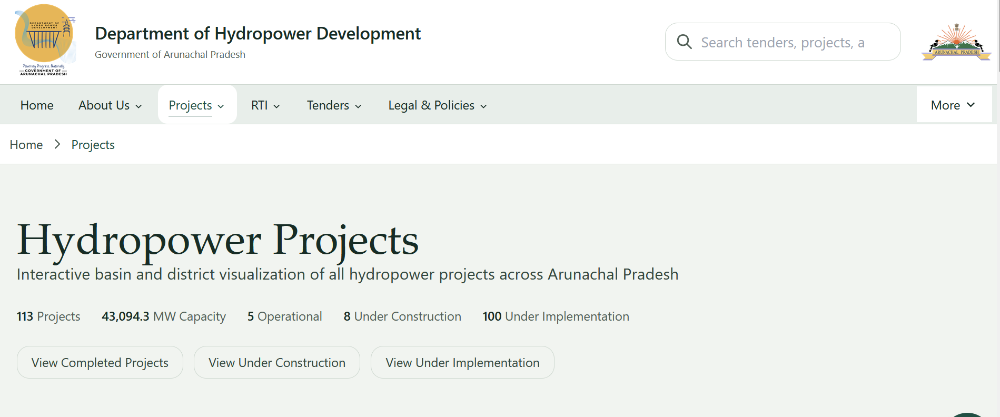

Projects completed: https://dhpdap.online/projects/completed

Projects under construction: https://dhpdap.online/projects/ongoing

Projects under implementation: https://dhpdap.online/projects/under-implementation

## About this folder

This folder holds hydropower project data from the DHPD portal, the Arunachal Pradesh hydropower projects website (https://dhpdap.online/). `all_projects.xlsx` is the main file: one row per project, with capacity, developer, district, river basin and status.

DHPD is the only source of power capacity figures in this repo. Forest clearance figures come from Parivesh (see `../parivesh/`). The two are never merged.

`data&exploration/` keeps the original downloads and working files that `all_projects.xlsx` was rebuilt from.

The data feeds the second dashboard, [Arunachal Dam Watch II](https://yania-n.github.io/Arunachal-Dam-Watch/v2/). See the main `README.md` for how it is built.
